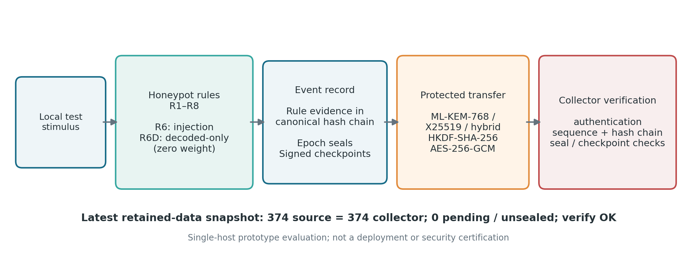
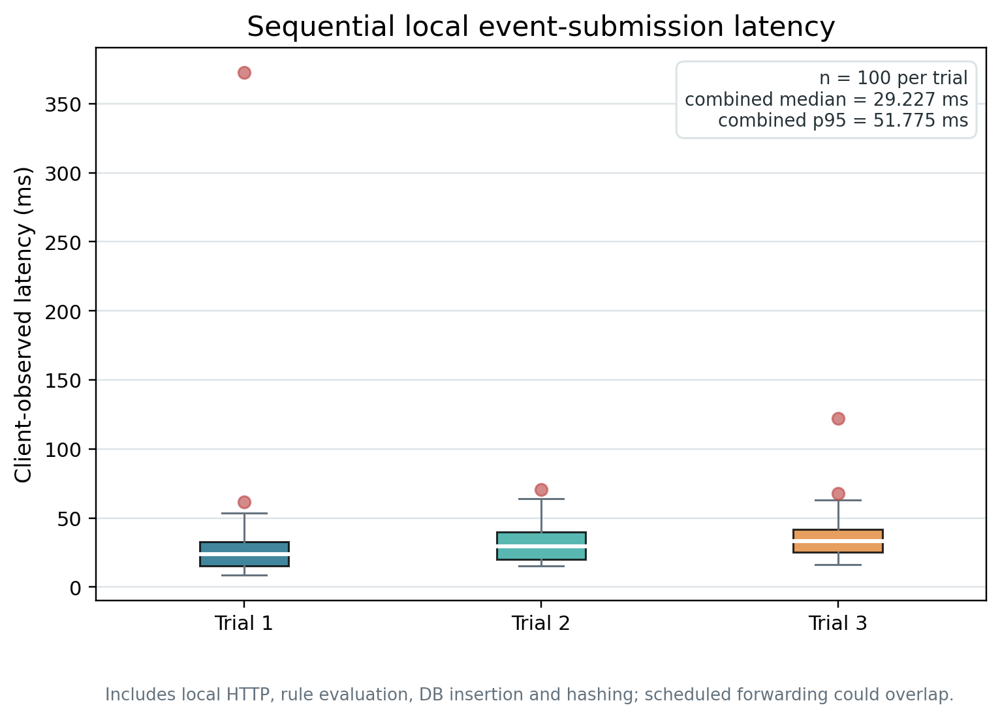
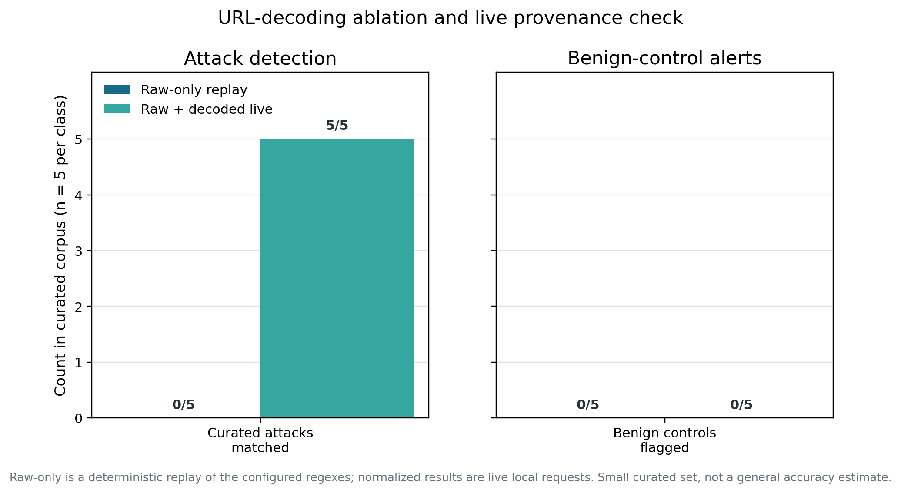
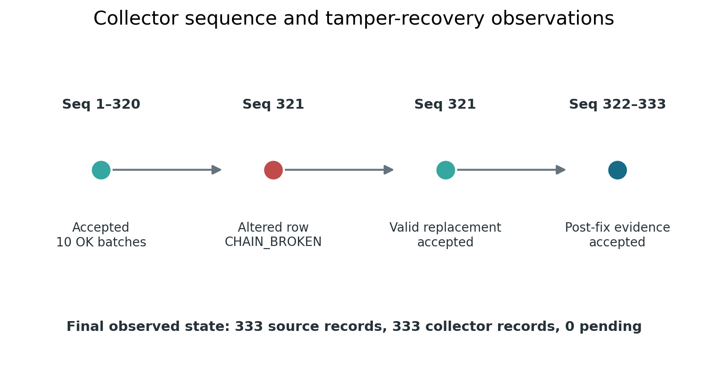
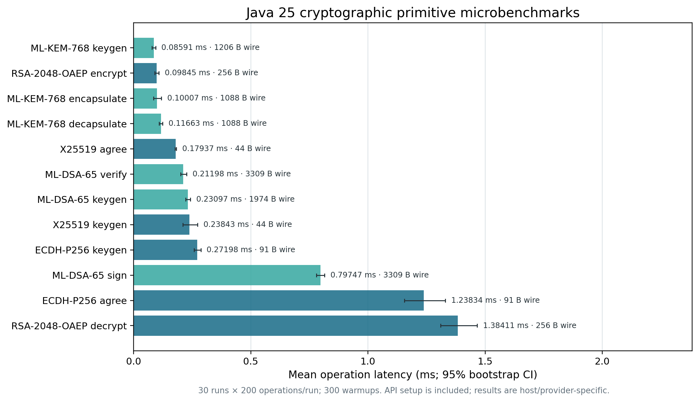
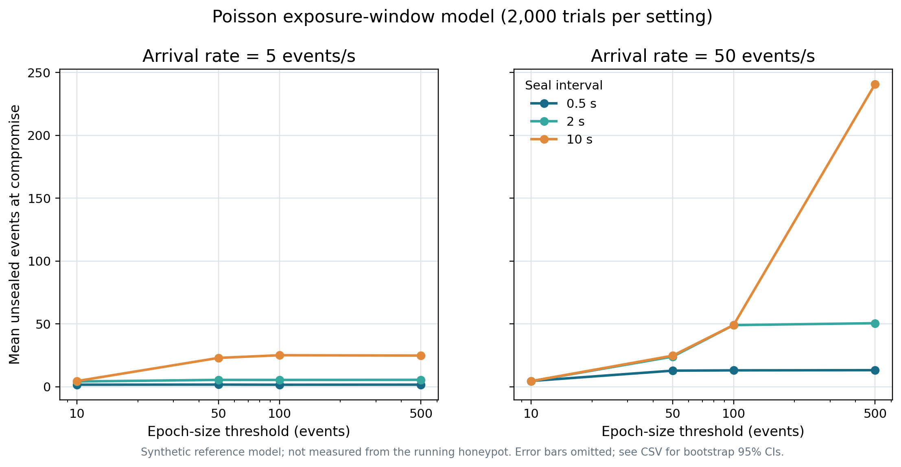
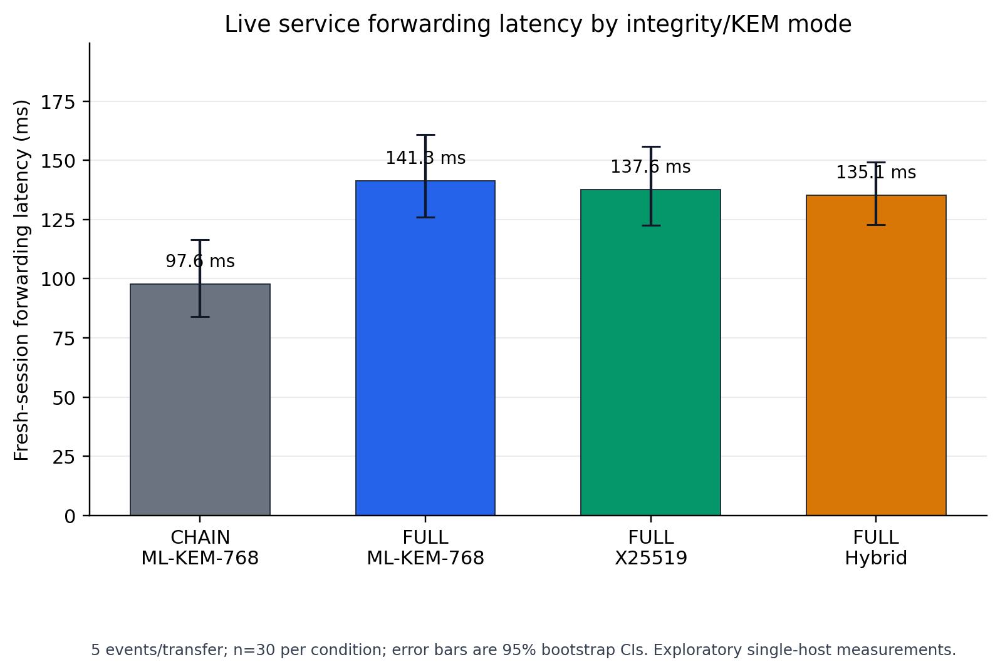
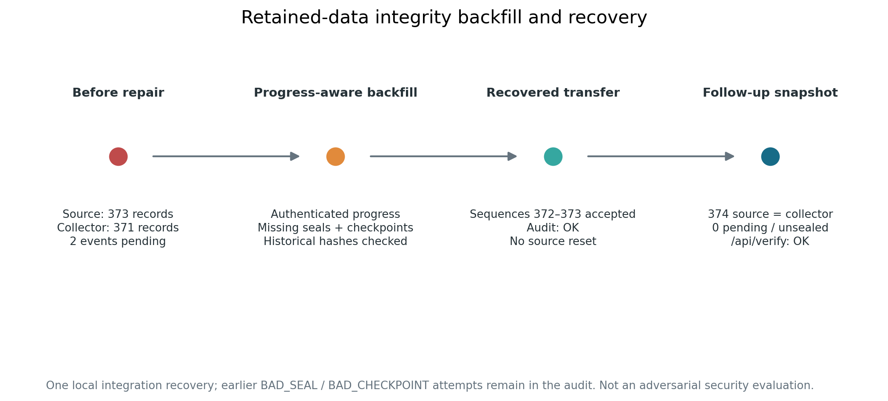

# Auditable Normalization Provenance for Tamper-Evident Evidence Forwarding in a Post-Quantum Honeypot: A Pilot Evaluation

**Authors:** Author names and affiliations not supplied  
**Study period:** 16–17 November 2026; research-layer runs added 17 November 2026

## Abstract

This paper evaluates a Java honeypot that scores requests, records events in a SHA-256-linked sequence, and forwards evidence to a collector using an authenticated encrypted channel. Its auditable normalization-provenance marker R6D records decoded-only injection matches with zero risk weight. In an isolated live-service run, five of five selected encoded indicators triggered R6/R6D and none of five benign controls triggered R6; a separate malformed-percent marker fired on one malformed benign input. All ten events were forwarded and verified. A controlled CHAIN-mode mutation of a pending event was rejected as `CHAIN_BROKEN`, while a clean event after an isolated reset was accepted. In a separate service benchmark, 30 fresh-session transfers were run for each of four integrity/KEM configurations. All 120 transfers (600 events) were accepted and verified. Mean client-observed forwarding latency ranged from 97.610 ms for CHAIN/ML-KEM-768 (95% bootstrap CI 83.995–116.524) to 141.300 ms for FULL/ML-KEM-768 (125.943–160.877); overlapping intervals and the exploratory design do not establish a performance ranking. A separate retained-data recovery forwarded sequences 372–373 without resetting the original database; the latest read-only snapshot reports 374 source and collector records, zero pending or unsealed events, and `/api/verify` status `OK`. The current Java 25 Maven suite passes 27/27 tests. Additional JCA microbenchmarks and a 2,000-trial-per-setting exposure-window sweep are reported separately; the latter is a reference model, not a live-service measurement. These pilot results show behavior on small curated inputs and one local host, not broad detection accuracy, production-grade security, resistance to adaptive attackers, or superiority over another honeypot.

**Keywords:** honeypot; ML-KEM; tamper-evident logging; event forwarding; AES-GCM; empirical evaluation

## 1. Introduction

Honeypots collect interaction data from systems that should attract unauthorized or suspicious requests. Such data is useful only when its origin and subsequent handling can be assessed. This project combines request classification, event hashing, and encrypted forwarding from a honeypot service to a collector. The attached SealFSv2 article provides relevant background on local tamper-evident logging and performance evaluation, but its file-system design and results are not directly comparable to this database-backed web application [1].

The closest direct overlap identified in the literature search is Sharmila et al.'s 2026 proposal for a quantum-resistant honeypot with AI-generated decoys [5]. That paper describes Kyber/Dilithium and adaptive decoy generation, and its results section reports approximately 90–95% detection accuracy and qualitative “low latency.” The inspected paper does not provide enough detail about the detection dataset, sample counts, repeated trials, hardware, or numeric latency values to support a reproducible head-to-head comparison. This project has no AI-generated decoy engine or Dilithium signatures; its narrower, measured focus is encrypted batch forwarding and tamper-evident event-chain checking.

This study asks four bounded questions:

1. Do the implemented cryptographic, hash-chain, and rule self-checks pass on the upgraded Java runtime?
2. Do locally generated events reach the collector with sequence and chain verification accepted?
3. What client-observed latency occurs for sequential synthetic event submissions on this particular machine?
4. Can the rule pipeline record whether a match required URL decoding while preserving the original risk score, and does that distinction survive evidence forwarding?

The paper makes three bounded contributions: (i) a zero-weight R6D indicator for distinguishing raw matches from decoded-only matches; (ii) an end-to-end implementation in which that indicator becomes part of the canonical hash-chained event and is forwarded through the existing authenticated encrypted channel; and (iii) a repeatable small-scale evaluation combining a raw-only matcher replay, live positive and benign-control requests, live integrity/KEM-mode forwarding measurements, and a controlled chain-tamper test. These are engineering and evaluation contributions, not a new cryptographic primitive or a claim of being the first system to combine these general technologies. The experiments use built-in self-tests and local decoy routes; no external hosts were contacted.

## 2. System under study

The application has two Spring Boot profiles. The honeypot profile exposes decoy login and administrative paths, applies sliding-window rules, stores event records, and links each record to its predecessor. The collector profile validates an authenticated handshake, derives session material with HKDF-SHA-256, and accepts encrypted evidence protected by AES-GCM. The configured handshake can use X25519, ML-KEM-768, or their hybrid. The source code also implements forward-secure epoch seals, ML-DSA-signed checkpoints, and collector-side persistence and verification. The collector checks sequence continuity and the event hash chain before storing accepted records. A later progress-aware handshake supports backfilling missing historical seals and checkpoints when the collector already contains the corresponding event records. The updated FULL path was exercised in successful local transfers and `/api/verify` checks, but no targeted negative attack matrix has yet tested tampering, replay, rollback, or truncation against each seal/checkpoint mechanism.

The implementation was examined in [CryptoService.java](./src/main/java/pqh/crypto/CryptoService.java), [HashChain.java](./src/main/java/pqh/crypto/HashChain.java), [EventService.java](./src/main/java/pqh/honeypot/EventService.java), [RulesEngine.java](./src/main/java/pqh/honeypot/RulesEngine.java), [ForwardService.java](./src/main/java/pqh/honeypot/ForwardService.java), and [CollectorController.java](./src/main/java/pqh/collector/CollectorController.java). ML-KEM is standardized in NIST FIPS 203 [2]; HKDF and GCM are specified in RFC 5869 [3] and NIST SP 800-38D [4], respectively.

The event chain is a hash-linked sequence, not an externally anchored or independently witnessed log. A party able to rewrite all unanchored source records may be able to recompute a chain. The live FULL-mode runs demonstrate successful configured transfers and verification, not resistance to targeted attacks or compromise of both endpoints.

Figure 1 summarizes the evaluated data path.

The user-facing dashboard on port 8080 supports local synthetic-event input and displays event, rule, forwarding, and verification summaries. The collector service on port 9090 provides machine-readable status and verification endpoints. These are evaluation and demonstration interfaces; they do not represent a production deployment or use third-party traffic.

### 2.1 Design contribution: normalization provenance

The initial encoded-query experiment showed a concrete limitation: the configured injection expressions matched a decoded representation but the rule engine had been checking only the raw query string. The revised detector evaluates both raw and URL-decoded payload forms. R6 still marks an injection-pattern match; R6D is added only when the decoded form matches and the raw form does not. R6D has a configured weight of zero, so it records why R6 fired without increasing risk score or changing the response policy. The existing event schema transports rule identifiers in `rules_hit`; the canonical event includes that field, so the provenance tag is committed into the existing event hash and protected by the existing encrypted transfer. The payload itself is not added to the event record.

The contribution is a traceability property of this prototype. It is not a general normalization framework, parser-differential defense, or proof that all encodings are safe. Its novelty relative to the compared works is the explicit recording of detection provenance within a tamper-evident, post-quantum-protected evidence pipeline; this narrow novelty claim requires broader independent comparison before publication as a priority claim.

### 2.2 Positioning against related work

| System | Main focus described in the cited work | Detection-normalization provenance in the evaluated description | Integrity/evidence emphasis | Reported evaluation and comparability |
|---|---|---|---|---|
| This project | Java honeypot and encrypted evidence transfer | R6D records decoded-only matches with zero score weight | Event hash chain, encrypted batches, collector sequence/chain checks | Local single-host measurements; curated five-positive/five-control rule corpus |
| SealFSv2 [1] | Tamper-evident file-system logging | Not its focus | Storage-based and ratcheting log protection | Different system layer and workload; not a direct honeypot benchmark |
| Sharmila et al. [5] | Quantum-resistant honeypot with AI-generated decoys; describes Kyber/Dilithium | No directly comparable decoded-only provenance evaluation was identified in the inspected paper | Emphasizes quantum-resistant decoys and detection | Reports approximately 90–95% detection, but the inspected description does not specify enough dataset, sample-count, hardware, and latency details for a reproducible head-to-head comparison |

The table identifies a difference in emphasis, not a ranking. The reported accuracy from [5] must not be compared numerically with this paper's 5/5 curated checks: the datasets, labels, test protocols, and denominators are not comparable. This project has not demonstrated that it outperforms that system.

The figures are reproducible from the included CSV data with `python generate-research-figures.py`; the provenance ablation applies the exact configured rule expressions to the checked-in query corpus. The literature comparison is a structured feature/results comparison rather than a head-to-head performance benchmark.

## 3. Experimental method

### 3.1 Environment

Experiments ran on Windows 11 Home (build 10.0.26300), an Intel Core i5-9300H processor (4 cores, 8 logical processors), and 7.9 GiB of reported physical memory. The running application used Eclipse Temurin OpenJDK 25.0.5, Spring Boot 3.5.16, Maven 3.9.6, and MySQL 8.4 containers. The web services listened on ports 8080 and 9090. The honeypot database was mapped to host port 3308 because port 3306 was occupied by a WSL relay; the collector database used port 3307.

The historical 8080/9090 experiment and the newer service-level benchmark used separate demo databases. The latter ran on ports 8081/9091 and reset only its isolated databases; it did not alter the retained dataset, which held 333 records at that earlier capture. Requests in the live classification and tamper checks originated from loopback. The application was run with Eclipse Temurin OpenJDK 25.0.5. The periodic forwarding task was set to a long interval during the fresh-session latency benchmark so it would not race manual transfers. The later integrity-metadata recovery used the retained 8080/9090 database and deliberately preserved its existing records.

### 3.2 Functional and integrity checks

The live `/internal/selftest` endpoint was run and its individual pass/fail results were recorded. It checks ML-KEM secret agreement, the RFC 5869 HKDF test vector, AES-GCM round-trip and rejection cases, counter-nonce distinction, hash-chain validation after edits/deletions/reordering, and selected rule behavior. The Maven JUnit suite was also run on Java 25 with `mvn test -q`.

These are functional checks of the implementation, not a formal cryptographic review. After a measured encoded-query miss, the rule engine was changed to evaluate both raw and URL-decoded payloads. R6D is emitted only for decoded-only matches and has zero weight. Tests check five encoded indicators, five encoded benign controls, malformed encoding, and equality of raw versus decoded-match risk scores. The in-memory hash-chain checks were complemented by one controlled database-row tamper experiment using the application's demo endpoint; only that altered test row was removed after rejection.

### 3.3 Request classification checks

Five sequential requests with incorrect credentials were sent to the local `/login` decoy using the same loopback source address and username. A second live corpus comprised five encoded injection-like indicators and five benign encoded controls sent to `/admin`; each request was loopback-only and generated an event. The sensitive-path rule R7 applies to all `/admin` requests, so HTTP 403 responses in this corpus are not evidence that the injection rule flagged the benign controls. For rule-specific analysis, the reported false-alert count is whether R6 or R6D fired. The configured injection regular expressions were also applied offline to the same corpus as a raw-only ablation. The live SQL-like scanner request was repeated to confirm the prior missed R6 had changed.

A separate repeatable service run sent five selected encoded indicators and five benign controls to `/admin` on the isolated research service. The test recorded R6 (injection match) and R6D (decoded-only provenance) separately and then forwarded the ten events in two batches. One malformed-percent benign control emitted the separate R6M marker; R6M is not counted as an R6 injection match in the reported classifier metrics. This small, hand-selected set is a functionality check, not a representative detection dataset.

### 3.4 Latency and forwarding

Three sequential trials each submitted 100 `POST /internal/simulate/honeytoken` requests over loopback. Each request generated one synthetic event. Five overview reads warmed the HTTP path before each trial. Client round-trip time was measured with Python's monotonic high-resolution timer; every HTTP status and latency sample was retained in [research-latency-samples.csv](./research-latency-samples.csv). Percentiles use the nearest-rank method. The measurement includes local HTTP handling, rule evaluation, database insertion, and event hashing; scheduled forwarding could run concurrently.

After the request and rule experiments, the overview and collector audit endpoints were checked for total records, pending events, and accepted sequence ranges. The built-in demo tamper endpoint then altered a newly generated pending row without updating its hash. The row was forwarded manually, its collector rejection was recorded, and only that controlled test row was deleted. A valid replacement using the same next sequence number was then forwarded and checked.

### 3.5 Live service mode comparison

The repeatable benchmark reset the isolated demo state before each trial, generated five local synthetic events, and timed one manual forward with a fresh authenticated session. It covered CHAIN/ML-KEM-768, FULL/ML-KEM-768, FULL/X25519, and FULL/hybrid, with 30 trials per condition. Timing uses a client-side stopwatch around the forward request and includes handshake, cryptographic processing, HTTP handling, and service/database work. Every trial required five accepted collector records, `/api/verify` status `OK`, and zero source events pending. The script computed a percentile-bootstrap 95% confidence interval for the mean from 5,000 resamples (seed 42), as well as median, nearest-rank p95, minimum, and maximum. These sequential single-host trials are descriptive; they are not randomized paired trials or a statistical test of mode differences.

## 4. Results

### 4.1 Test and self-check outcomes

At the earlier live R6D capture, the application self-test passed 17/17 checks and the then-current JUnit suite passed 6/6 tests. The current Java 25.0.5 Maven suite passes 27/27 tests across six test classes, including collector metadata verification, primitive, codec, KEM agreement, checkpoint-signature, and key-provisioning tests; the standalone research self-check passed 22/22 checks. The unit tests run in-process; separate live service-mode and detector results are reported in Sections 4.3, 4.4, 4.7, and 4.8. Both application root pages returned HTTP 200, and the current collector verification endpoint returned `OK`. These outcomes establish only that the tested paths executed successfully; they are not a formal cryptographic review.

### 4.2 Local request latency

All 300 measured submissions returned a successful HTTP response. The run summaries are shown below and retained in [research-results.csv](./research-results.csv).

| Trial | Requests | Successful | Mean (ms) | Median (ms) | p95 (ms) | Min (ms) | Max (ms) |
|---|---:|---:|---:|---:|---:|---:|---:|
| 1 | 100 | 100 | 27.796 | 23.868 | 41.966 | 8.622 | 372.663 |
| 2 | 100 | 100 | 30.839 | 29.675 | 49.825 | 15.107 | 70.737 |
| 3 | 100 | 100 | 35.183 | 33.103 | 57.100 | 16.302 | 122.261 |
| **Combined** | **300** | **300** | **31.273** | **29.227** | **51.775** | **8.622** | **372.663** |

The first trial's observed maximum was 372.663 ms. The median and p95 are therefore more representative of the observed run than its maximum, but the three trials are still a small single-host sample. These timings should not be interpreted as a capacity guarantee or compared directly with file-system benchmarks.

These are the earlier pre-R6D throughput baseline, not a controlled before/after performance experiment for the provenance marker. No overhead or non-inferiority claim is made for R6D.

### 4.3 Rule behavior

| Local stimulus | Observed outcome | Interpretation |
|---|---|---|
| Five failed `/login` requests from the same loopback address and username | Five HTTP 401 responses; first four records scored 0/LOW; fifth scored 40/MEDIUM with R1 | The configured brute-force threshold fired on the fifth isolated attempt |
| `GET /admin?probe=../safe` with a `sqlmap`-labelled test user-agent | HTTP 403; score 65/HIGH; R5, R6, and R7 recorded | Scanner, traversal-pattern, and sensitive-path rules all fired |
| Before fix: `GET /admin?probe=union%20select%20local_test` with the same test user-agent | HTTP 403; score 35/MEDIUM; R5 and R7 fired, R6 did not | Baseline miss: the SQL-injection matcher did not decode the percent-encoded query |
| After fix: same live encoded request | HTTP 403; score 65/HIGH; R5, R6, R6D, and R7 recorded | The SQL-injection rule now matches the URL-decoded query; R6D identifies the decoded-only match |
| Built-in honeytoken simulation | One inspected event scored 50/MEDIUM with R8 | The configured honeytoken rule was exercised |

The encoded-query case was an observed detection gap, not an assumed result. Before the normalization change, the live request remained classified by the scanner and sensitive-path rules but did not trigger R6; its recorded score was 35/MEDIUM. After the change, the same scanner-labelled request triggered R6 and R6D as well as R5 and R7, scored 65/HIGH, and returned HTTP 403. The separate five-positive/five-control live corpus produced R6 on 5/5 encoded indicators, R6D on 5/5, and R6/R6D on 0/5 benign controls. On the same curated inputs, raw-only regex replay matched 0/5 encoded indicators and 0/5 benign controls. This replay is an algorithm ablation, not a second historical live run. The curated sample is too small and selected to estimate field detection accuracy, general false-positive rates, or robustness to adaptive traffic. The built-in brute-force simulation was not used to establish the isolated threshold: its randomized TEST-NET source address overlapped earlier synthetic traffic.

In the separate 8081/9091 live detection run, the selected five positive cases all triggered R6 and R6D (5/5), while none of five benign controls triggered R6 (0/5). For this narrow R6 label, sample accuracy was 10/10, precision 5/5, recall 5/5, and specificity 5/5. One benign `100%` input also raised R6M because its percent escape was malformed; it did not raise R6 and is not included as an injection-rule false positive. All ten events were accepted in two batches and the collector reported `/api/verify` `OK`. The sample is too small and selected to estimate general detection performance.

| Corpus-specific metric | Raw-only regex replay | Raw + URL-decoded live matcher |
|---|---:|---:|
| Encoded indicators matched | 0/5 | 5/5 |
| Encoded indicators marked decoded-only (R6D) | Not applicable | 5/5 |
| Benign controls triggering R6/R6D | 0/5 | 0/5 |
| Score change from adding R6D | Not applicable | 0 points by configuration; raw/decoded score equality passed unit and live self-checks |

For the five encoded indicators, the apparent detection recall changes from 0/5 in the raw-only replay to 5/5 in the live normalized implementation. For the five benign controls, both variants produce 0/5 rule-specific alerts. These are descriptive counts on this hand-selected corpus only, not population-level rates.

### 4.4 Evidence delivery

The original performance and rule experiments generated 320 event records. The collector reported all 320 stored and no pending source events. In the tamper experiment, the collector returned `CHAIN_BROKEN` at link index 0 for altered sequence 321 and did not store it. After removing only that altered source row, a valid replacement at sequence 321 was accepted. The initial post-fix live event at sequence 322 was also accepted. Following the R6D implementation, the ten encoded-corpus events (sequences 323–332) and a scanner-labelled encoded request (sequence 333) were accepted. At capture, the source and collector each held 333 records with zero pending events. This demonstrates the observed local chain-check, recovery, and forwarding path; it does not establish correct handling of every network failure, replay, or concurrent-session case.

In the isolated CHAIN-mode tamper test, the demo endpoint changed a pending event without updating its stored hash. The collector returned `CHAIN_BROKEN (seq 1-1)` and stored zero records; its verification endpoint remained `OK` for the empty dataset. After resetting only the isolated demo databases, a clean sequence-1 event was accepted and verified, with no pending source events. This is a chain-integrity check plus clean-state recovery, not a test of recovery while preserving the altered database row or of FULL-mode seal/checkpoint rejection.

### 4.5 Cryptographic primitive microbenchmark

The research runner measured key generation/agreement for X25519 and P-256 ECDH, ML-KEM-768 key generation/encapsulation/decapsulation, RSA-2048 OAEP encryption/decryption, and ML-DSA-65 key generation/signing/verification. It ran 30 timed groups of 200 operations after 300 warmups per operation. The 95% confidence intervals are percentile bootstrap intervals over the 30 per-run means (5,000 resamples, seed 42). Reported times include JCA object creation and setup inside the timed operation where the runner performs it; they are microbenchmark results on this host/runtime/provider, not end-to-end handshake timings.

| Scheme / operation | Mean ms | 95% bootstrap CI (ms) | Public-key bytes | Payload bytes | Wire bytes |
|---|---:|---:|---:|---:|---:|
| X25519 keygen | 0.23843 | 0.20966–0.27314 | 44 | 0 | 44 |
| X25519 agree | 0.17937 | 0.17637–0.18278 | 44 | 32 | 44 |
| ECDH-P256 keygen | 0.27198 | 0.25754–0.28698 | 91 | 0 | 91 |
| ECDH-P256 agree | 1.23834 | 1.15584–1.33037 | 91 | 32 | 91 |
| ML-KEM-768 keygen | 0.08591 | 0.07859–0.09392 | 1,206 | 0 | 1,206 |
| ML-KEM-768 encapsulate | 0.10007 | 0.08438–0.11812 | 1,206 | 1,088 | 1,088 |
| ML-KEM-768 decapsulate | 0.11663 | 0.10912–0.12423 | 1,206 | 1,088 | 1,088 |
| RSA-2048 OAEP encrypt | 0.09845 | 0.09011–0.10750 | 294 | 256 | 256 |
| RSA-2048 OAEP decrypt | 1.38411 | 1.30991–1.46574 | 294 | 256 | 256 |
| ML-DSA-65 keygen | 0.23097 | 0.22175–0.24230 | 1,974 | 0 | 1,974 |
| ML-DSA-65 sign | 0.79747 | 0.78010–0.81468 | 1,974 | 3,309 | 3,309 |
| ML-DSA-65 verify | 0.21198 | 0.20109–0.22597 | 1,974 | 3,309 | 3,309 |

These values should not be treated as a comparative ranking across security levels or implementations. Encoding lengths include the Java provider's encoded public-key representation, and `wire_bytes` describes the operation-specific public key, encapsulation, ciphertext, or signature represented by that row; it is not a complete protocol transcript size. Raw per-run samples and summary values are in `results/kem_micro_samples.csv` and `results/kem_micro.csv`.

### 4.6 Exposure-window and attack reference models

The exposure runner simulated Poisson event arrivals at 5 or 50 events/s, compromise times uniformly sampled from 20–40 seconds, and epoch seals triggered by either the event-count threshold or elapsed seal interval. It ran 2,000 trials for each of the 24 configured combinations and used 2,000 bootstrap resamples for the mean confidence intervals. At 50 events/s and a 50-event threshold, the model estimated a mean of 12.765 exposed events (95% CI 12.395–13.125; p95 27) with a 500 ms interval, versus 24.696 (95% CI 24.061–25.329; p95 47) with a 10 s interval. Across the tested settings, the largest mean was 240.755 events (95% CI 234.717–247.384; p95 468) at a threshold of 500, interval 10 s, and rate 50 events/s. These are outputs of a simplified model, not observed seal behavior in the Spring application.

The 200-trial attack matrix and its `ExpectedMatrixTest` are also explicitly model-only (`REFERENCE_MODEL`). The reference semantics predict detection of 200/200 backlog rewrites with ratcheting enabled and 0/200 without it; signed anchors detect 200/200 consistent collector-chain rewrites in the reference implementation. Tail truncation and injection into the current unsealed epoch remain undetected in all reference modes. A live CHAIN-mode pending-row tamper test is reported in Section 4.4, but `RealTarget` and the broader real-service attack matrix remain incomplete. Consequently, these reference percentages are not empirical security results for the honeypot or collector.

### 4.7 Live service forwarding comparison

All trials used five events per transfer. Each of the four conditions completed 30/30 accepted and verified transfers, for 120 transfers and 600 accepted events overall. Latency is client-observed elapsed time for a fresh-session forward; values are not throughput measurements. The `CHAIN` baseline and `FULL` rows differ in integrity configuration, while the FULL rows also differ in KEM choice, so these rows should not be read as isolated causal effects.

| Integrity mode | KEM mode | Trials | Accepted | Mean ms (95% bootstrap CI) | Median ms | p95 ms |
|---|---|---:|---:|---:|---:|---:|
| CHAIN | ML-KEM-768 | 30 | 30/30 | 97.610 (83.995–116.524) | 84.795 | 189.560 |
| FULL | ML-KEM-768 | 30 | 30/30 | 141.300 (125.943–160.877) | 124.521 | 300.882 |
| FULL | X25519 | 30 | 30/30 | 137.618 (122.541–155.985) | 116.068 | 251.551 |
| FULL | Hybrid | 30 | 30/30 | 135.125 (122.765–149.167) | 119.210 | 209.908 |

The intervals overlap, and the measurements were not randomized or paired. They do not support a claim that one KEM or integrity mode is faster, more secure, or superior. The raw per-trial data and summary table are in `results/live-service-FULL-ML_KEM_768.csv`, the corresponding X25519, hybrid, and CHAIN files, and `results/live-service-comparison.csv`.

### 4.8 Retained-data integrity backfill and recovery

The retained local source had 373 events, while the collector held events through sequence 371 and had not accepted corresponding seal/checkpoint progress. Two source events therefore remained pending. Initial recovery attempts exposed a checkpoint backfill gap and were recorded as `BAD_SEAL` / `BAD_CHECKPOINT`; these were integration failures, not attack-trial outcomes. The implementation was updated to exchange authenticated progress for both seals and checkpoints and to validate historical integrity metadata against event hashes already stored by the collector. No retained rows were reset or deleted. The collector then accepted sequences 372–373, and the audit recorded `OK: stored 372-373`.

A subsequent read-only endpoint snapshot observed 374 source records, 374 collector records, zero pending events, zero unsealed events, and `/api/verify` status `OK`; the latest audit entry was `OK: stored 374-374`. This later count is an operational state snapshot, not an additional controlled benchmark trial. The snapshot is retained in [results/live-retained-state.csv](./results/live-retained-state.csv), and Figure 8 summarizes the recovery sequence.

## 5. Discussion

The measurements show that the application completed its tested local ingest and forwarding flow on Java 25: 300 of 300 requests succeeded in the historical request run, the R6D capture ended with 333 records and no events pending, and 120 new isolated service transfers accepted and verified all 600 events. The later retained-data recovery accepted the previously pending sequences without resetting the database; a follow-up read-only snapshot reported 374 source and collector records, zero pending or unsealed events, and verification `OK`. The R6D marker exposes whether an R6 result depends on URL decoding while leaving the score unchanged; live tests confirmed this behavior. The controlled CHAIN-mode test also rejected a pending-row mutation. These outcomes support functional claims for the exercised paths, not a hardened production-service or comprehensive security claim.

The design differentiator is auditability of normalization: R6D communicates that a pattern was exposed by decoding, and because `rules_hit` is part of the canonical event, the provenance marker travels inside the chain-verified encrypted evidence. The score is unchanged because R6D is zero-weight. The live corpus showed 5/5 selected indicators matched and tagged, with 0/5 controls triggering the injection rule. This is promising evidence for the implementation's intended behavior but not a meaningful accuracy benchmark. Larger, independently curated corpora and parser/encoding diversity are necessary.

The 372.663 ms maximum in the first latency trial also warrants a larger, repeated study before making performance claims. The current experiment is sequential, local, and small; it does not measure concurrent load, sustained throughput, resource consumption, network delay, cold-start behavior, or a baseline without cryptographic forwarding. The timing includes background scheduled forwarding and is therefore a system-level observation rather than a microbenchmark of any single primitive.

The new live benchmark provides a service-level latency observation across selected KEM/integrity configurations, but it does not isolate the cost of each feature: trials were sequential, single-host, non-randomized, and included handshake and database work. The sample is not a throughput or resource-consumption study. The exposure and broad attack-matrix runners remain models and must not be presented as empirical evidence of service security. FULL-mode happy-path acceptance was observed, but targeted live tests of forged seals/checkpoints, replay, rollback, and tail truncation remain outstanding.

Finally, chain verification should be described narrowly. The current chain and collector checks can reveal changes inconsistent with previously accepted state, while an unanchored local chain alone does not prevent an attacker with full rewrite access from recomputing the chain. Operational claims should account for trust in the collector, key/PSK protection, database access control, and recovery after service restart.

## 6. Recommended follow-up actions

1. Extend the encoded-input evaluation to larger, independently curated attack and benign corpora, including double encoding and alternate encodings.
2. Repeat the latency experiment with more runs and concurrent clients; report resource use and confidence intervals.
3. Add end-to-end negative tests for modified ciphertext, replayed batches, and sequence gaps, without using real third-party traffic.
4. Define and test the threat model for source-database compromise, collector compromise, PSK rotation, and chain anchoring.
5. Measure R6D processing overhead using a controlled paired benchmark with and without provenance tagging.
6. Before publication, add author/affiliation details and state whether the manuscript is a project report, thesis chapter, or research submission.
7. Test FULL-mode tampering, re-chaining, replay, checkpoint corruption, rollback, and tail truncation against isolated live services; compare observed behavior with the reference matrix.
8. Expand the detection run to a larger, independently curated set (including the planned 1,000 positive and 500 benign cases) before estimating population-level performance.
9. Repeat the service benchmark with randomized/paired order, more hosts, and concurrent clients; report resource use and test differences with an appropriate statistical design.

## 7. Conclusion

This pilot introduces and evaluates R6D, a zero-weight event marker that records when an injection rule matches only after URL decoding. It preserves the risk score while making normalization dependence visible in hash-chained, encrypted evidence. Live tests found 5/5 selected indicators and 0/5 R6 alerts on benign controls; a malformed benign input separately raised R6M. The updated service accepted and verified 120/120 fresh-session transfers across four configurations, and a CHAIN-mode pending-row mutation was rejected. Progress-aware backfill recovered two retained pending records without resetting the database; a later snapshot found 374 source and collector records, zero pending or unsealed events, and verification `OK`. The current Java 25 suite passes 27/27 tests. These results establish only the tested local behavior. The sample sizes and single-host latency design are insufficient for broad performance or detection claims, and the reference attack matrix is not a live security evaluation. The results support a working prototype and a modest traceability contribution, not a claim that the system beats competing honeypots. Larger independent datasets, targeted FULL-mode attacks, and a stronger comparative study are needed.

## Data and reproducibility

The consolidated result tables are available in [results/tables.md](./results/tables.md). Environment and research-run configuration are recorded in [results/environment.json](./results/environment.json). The live detector inputs and outputs, CHAIN tamper observation, retained-data snapshot, per-trial forwarding CSVs, primitive benchmark, exposure-window model, and reference attack matrix are retained under `results/`. Figures 1–6 and 8 can be regenerated with [generate-research-figures.py](./generate-research-figures.py); the service comparison figure is regenerated from the four live-service summary CSVs with [generate-live-service-figure.py](./generate-live-service-figure.py). The consolidated tables are regenerated with [generate-research-tables.py](./generate-research-tables.py). Run the Java test suite with `mvn test` on Java 25. The live-service, detector, and tamper scripts are documented in [LIMITATIONS.md](./LIMITATIONS.md); they use local demo services and must target only their designated isolated research databases.

## References

1. Guardiola-Múzquiz, G., Soriano-Salvador, E.: SealFSv2: combining storage-based and ratcheting for tamper-evident logging. *International Journal of Information Security* 22, 447–466 (2023). https://doi.org/10.1007/s10207-022-00643-1
2. National Institute of Standards and Technology: *Module-Lattice-Based Key-Encapsulation Mechanism Standard*, FIPS 203 (2024). https://csrc.nist.gov/pubs/fips/203/final
3. Krawczyk, H., Eronen, P.: *HMAC-based Extract-and-Expand Key Derivation Function (HKDF)*, RFC 5869 (2010). https://www.rfc-editor.org/rfc/rfc5869
4. Dworkin, M.: *Recommendation for Block Cipher Modes of Operation: Galois/Counter Mode (GCM) and GMAC*, NIST SP 800-38D (2007). https://csrc.nist.gov/pubs/sp/800/38/d/final
5. Sharmila, Sakthivel D., Louis Gaspal J., Rahul V.: *Quantum Resistant Honeypot with AI Generated Decoy Ecosystem*. International Research Journal of Modernization in Engineering Technology and Science, 8(4), 5548–5554 (2026). https://doi.org/10.56726/IRJMETS94768
